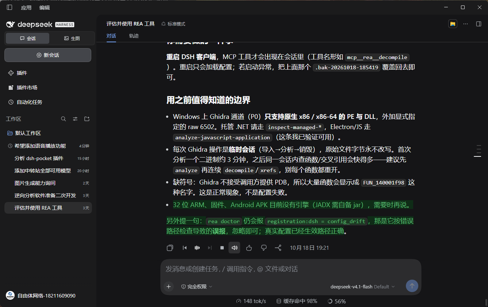
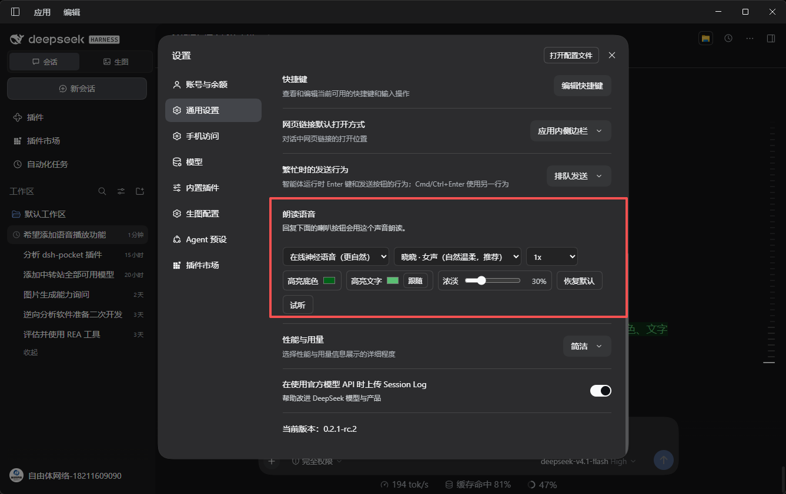

# dsh-read-aloud-neural

在 DeepSeek Harness 的每条回复旁加一个**音浪按钮**，点击就能听到这条回复。语音用的是微软 Edge 的在线**神经音色**，比浏览器自带的机器音自然得多。

朗读时会**高亮当前正在读的那一句**，方便一边听一边看。高亮长什么样由你定：**底色、文字颜色、浓淡**三样都能在设置里调。

> Read DSH replies aloud with natural neural voices: a sound-wave play button, highlighting of the sentence being spoken, pause/skip controls, configurable highlight colours, and auto-read.





## 功能

| 功能 | 说明 |
| --- | --- |
| 音浪播放键 | 点一下开始朗读；朗读时音浪起伏，一眼看出正在播放 |
| 当前句高亮 | 读到哪句亮哪句，高亮底色、文字颜色、浓淡都能在设置里调 |
| 播放控制 | 暂停 / 继续、上一句、下一句、停止 |
| 自动朗读 | 喇叭开关：开启自动读新回复，关闭时喇叭带斜线 |
| 音色丰富 | 14 个中文音色，含**东北话、陕西话、粤语、台湾国语**，以及多个英文音色 |
| 语速可调 | 0.75x 到 2x |
| 智能跳过 | 代码块、表格、链接地址不念，只读正文 |
| 边读边合成 | 合成一句播一句，同时预取下一句，听起来是连续的 |

## 安装

通过插件市场安装，或者用命令行：

```bash
dsh plugin --profile web add dsh-read-aloud-neural
```

安装后在 **设置 → 通用 → 朗读语音** 里选择音色和语速。

## 使用

1. 在任意一条回复下方点击**音浪按钮**开始朗读。
2. 朗读过程中可以暂停、跳句、停止。
3. 想让它自动读新回复，点旁边的**喇叭按钮**开启。
4. 高亮颜色不满意？在设置里改**高亮底色 / 高亮文字 / 浓淡**，改完立即生效。

## 注意：语音来源与隐私

这一节请务必读一下：

- **语音由微软 Edge 的在线朗读服务合成。** 插件使用的是该服务的公开终端点，并模拟 Edge 浏览器的请求特征。**这并非微软官方授权的接口用法**，属于灰色地带，随时可能失效或被限制。
- **你的回复文本会被发送到微软的服务器**，这是在线语音的必然结果。介意的话请不要使用本插件，或改用系统自带语音（设置里可切换为“系统语音（离线）”，那个版本完全在本机合成）。
- 插件的本地服务只监听 `127.0.0.1`，且校验来源请求头与 Host，外部网络无法访问。
- 插件**不收集任何遥测数据**，不上报使用情况。
- 高亮功能在定位失败时会在系统临时目录写下诊断文件（`dsh-read-aloud-report-*.json`），内含少量回复文本，用于排查问题，可随时删除。

## 环境要求

- DeepSeek Harness，使用 Web GUI（桌面版）
- 需要联网（在线神经语音）
- 高亮功能依赖 Chromium 的 CSS Custom Highlight API，DSH 桌面版内置的 Chromium 支持

## 开发

插件分为两半：

- **宿主侧**（`index.js` / `tts.js` / `ws-client.js`）：注册 `/read-aloud/*` 本地路由，负责与语音服务通信、缓存音频。
- **前端侧**（`client.js`）：注册聊天操作栏按钮与设置项，负责文本分句、播放调度、句子高亮。

不依赖任何第三方包，WebSocket 客户端（`ws-client.js`）是自己实现的，因为该语音服务要求自定义握手请求头。

跑测试：

```bash
node smoke-test.cjs   # 偏好设置、按钮、分句、匹配逻辑
node dom-test.cjs     # 高亮定位（含 DOM 模拟）
```

## 协议

MIT
